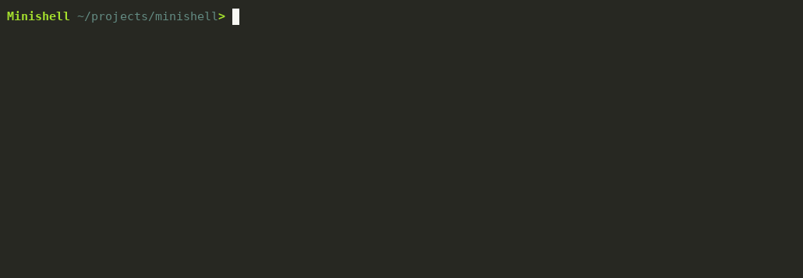
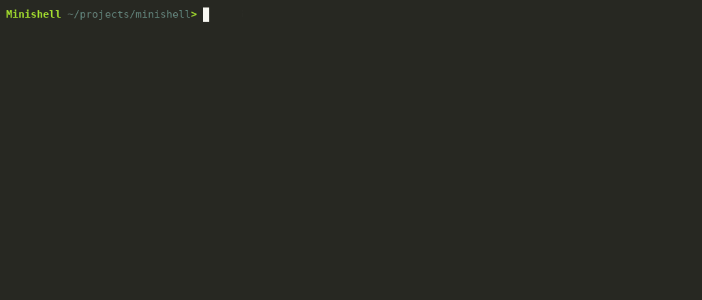
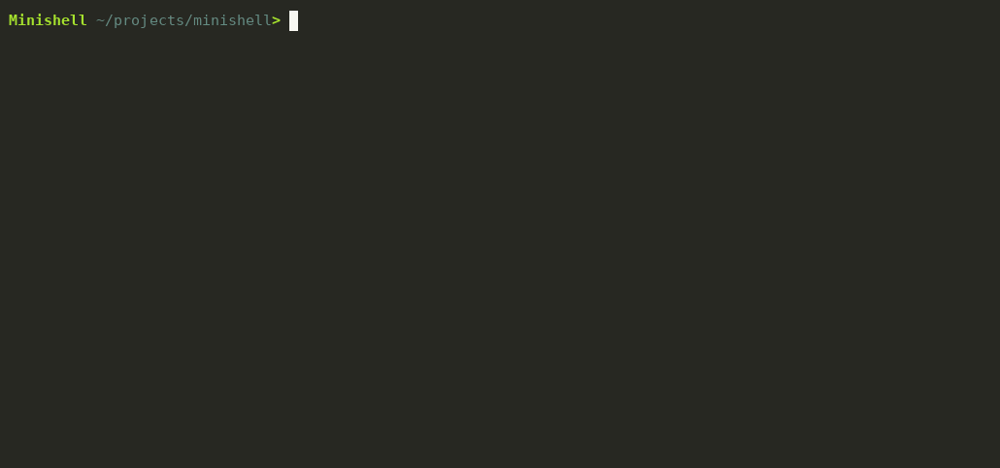

<div align="center">

# minishell

*File descriptors, forks, and the occasional segfault — a Unix shell written from scratch in C.*




</div>

A small interactive shell: it lexes, expands, splits and executes everything itself. No
`system()`, no shell library, no shortcuts — `readline` is the only dependency, and only
for line editing.

## What works

| | |
|---|---|
| **Pipes** | `a \| b \| c`, each stage forked and wired with `dup2` |
| **Redirections** | `<`, `>`, `>>` on builtins and external commands; multi-line `<<` heredocs |
| **Expansion** | `$VAR`, `$?`, quote-aware splitting, `a""b` → `ab` |
| **Quoting** | `'literal $HOME'` stays literal, `"expanded $HOME"` expands |
| **Builtins** | `echo -n`, `cd`, `pwd`, `export`, `unset`, `env`, `exit` |
| **Shell manners** | colored prompt with `~`, ↑/↓ history, `Ctrl-C`, `Ctrl-D`, exit codes (`127`, `130`, `1`) |

```text
Minishell ~/projects/minishell> false
◉ Minishell ~/projects/minishell> echo $?
1
```

## One line, start to finish

```text
readline()
   ├─ lexer       quote-aware tokens          src/3_parsing/3_2split_command/
   ├─ expander    $VAR, $?, quote rules       src/3_parsing/3_1dollex/
   ├─ builder     commands, args, redirects   src/3_parsing/
   └─ executor
        ├─ single builtin  → parent process (cd/export must stick)
        ├─ builtin in pipe → fork
        └─ pipeline        → pipe + fork + dup2 + execve + waitpid
```

## Pushed to the edges

Five recordings, one take each, straight from the binary — the prompt, the errors and the
status bytes are the shell's own. Nothing is replayed or stitched.

**State lives in the shell, not in a child.**


`A` starts as `mini` and grows eight times per line: four self-referential `export`s later
it holds 16,384 characters, and `echo $A` floods the terminal with them. `wc -c` returns
`16385` (the newline), `env | grep '^A=' | wc -c` returns `16387` (`A=` plus newline), so
the bytes really are in the environment, not just in a buffer. The same shell keeps `$PWD`
and `$OLDPWD` in sync through `cd`, and `cd .. hi` is refused instead of half-applied.

**Sixty-four stages, ten million lines, no zombies.**


`echo hi` crosses 64 `cat` processes and arrives once. A million `seq` lines are counted,
`head -n 3` stops a 9,999,999-line producer early (GNU `seq` even reports the broken pipe),
and `/dev/zero` is cut to eight bytes before `od` sees it. Afterwards `ps` lists only the
shell and `ps` itself — no `Z` — and `nosuch | cat` reports the last stage's status (`0`),
not the failed stage's `127`.

**A heredoc inside a heredoc inside a heredoc.**


Each level feeds the next shell's source through a quoted heredoc:

```sh
cat <<'L1' | ./minishell > /dev/null
cat <<'L2' | ./minishell > /dev/null
cat <<'L3' | cat -A > /dev/tty
  three shells deep: $USER | ; * `id` ~
L3
L2
L1
```

Quoted delimiters stop expansion at every layer, `> /dev/null` hides the nested prompts,
and only the innermost `cat -A` writes to the terminal — through `/dev/tty`, because its
stdout is a pipe. Three shells parsed the nesting, but none of them parsed the final line:
that is why `$USER`, `|`, `;`, `*` and backticks arrive intact, ending in a `$` from
`cat -A`.

**Quotes disappear; the bytes do not.**


`e"ch"o` becomes `echo`, `bon""jour` becomes `bonjour`, and in `co'c"o"u'` the double
quotes stay literal because single quotes protect them. A quoted `"-n     mdr"` prints as
text and `-n-n` is not an option. Unquoted `a  b` is two arguments; quoted `"a  b"` is one.
The same rule decides redirection targets: `echo > test'sticked' bonjour` writes `bonjour`
to `teststicked`, `> "two words"` keeps the space, and `echo hi | cat > out | wc -l` applies
the redirect to that stage only, so `wc` sees an empty pipe and prints `0` while `out` still
receives `hi`.

**The status byte, and the values around it.**


The clip starts three shells deep, then uses a fresh child for each case. `exit 7` and
`exit 156` come back as themselves; `exit -1` collapses to `156`; `exit +3` is accepted as
`3`; `exit 2000000` exits with `2000000`, which the OS truncates to `128`. The largest
64-bit values are the interesting ones: `9223372036854775806` and `9223372036854775807`
parse, then narrow to a negative `int` on the way out, so the builtin reports `1` and
returns to the prompt instead of terminating the shell; one past the maximum is rejected
with `numeric argument required` and status `2`. After every nested shell exits, the
parent's `$?` is read back with `echo` — no captured variable, no simulation.

## Three things that were harder than they look

**Builtins can't always fork.** `cd` and `export` change the shell itself, so a lone
builtin runs in the parent; the same builtin inside a pipe runs in a child. One branch,
two very different lifetimes.

**Heredocs.** Read the body with `readline("> ")` into a temp file, then hand it over as
input. Trying to swallow the whole stream up front deadlocks the moment a pipe follows.

**Memory.** Tokens are allocated everywhere, including on error paths. A tiny intrusive
list (`ft_gc_malloc` / `ft_gc_cleanup`) owns every pointer, so a failed parse or a `^C`
leaves nothing behind.

## The 42 Norm

Written under the school's formatting rules — **25 lines per function, 5 functions per
file, 4 parameters max, 80-column lines, tabs for indentation**, no `for`/`do-while`/`switch`.
It feels absurd until it doesn't: small functions with one job are easier to defend in a
review than a clever 200-line parser.

## Build

```bash
make          # gcc + libreadline-dev
./minishell
```

`make re` rebuilds, `make fclean` wipes objects and the binary.

## Not in scope

- `;`, `&&`, `||` and subshells — this is the mandatory-part shell, not a bash clone.

## Layout

```text
src/1_env/            environment list, export/unset semantics
src/2_input/          readline, signals, input strings
src/3_parsing/
│   ├── 3_1dollex/        $VAR and $? expansion
│   ├── 3_2split_command/  quotes, pipes, redirections
│   ├── 3_3split_args/    argv construction
│   └── commands_utils.c  shared parsing helpers
src/4_execution/
│   ├── 4_1pipeline/      pipe + fork + dup2
│   └── 4_2command/       builtins, execve, heredocs
src/5_builtins/       echo cd pwd export unset env exit
src/errors/           messages and exit-status mapping
include/              headers
utils/libft/          1,175-line C library (37 files)
utils/ft_gc.c         allocation tracker
docs/demo.gif          the tour above
docs/variables.gif     four exports → 16 KiB of state
docs/pipes.gif         64 cats, ten million lines, no zombies
docs/heredoc.gif       a heredoc inside a heredoc inside a heredoc
docs/quoting.gif       quote gluing, splitting, redirect targets
docs/status.gif        nested shells, exit statuses around the limits
```

The numbers are my own convention, not a 42 rule: the first digit is the
pipeline stage, the second is the sub-stage (`4_2command` runs inside
`4_execution`). Reading order and depth are visible in `ls`.

About **3,000 lines** of shell plus the libft.

## Credits

42 Paris, by [@edouwarden](https://github.com/edouwarden) and Julien Sarter.
